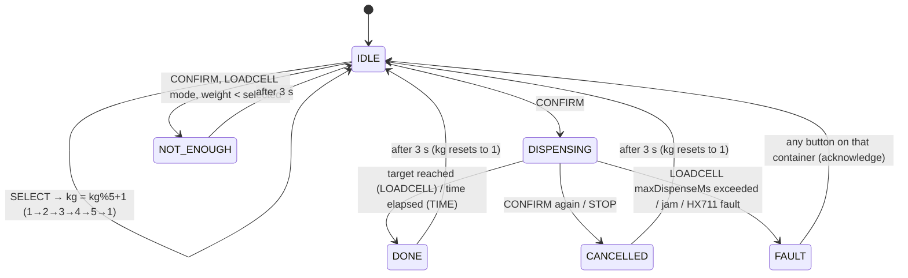

# Module: Containing (esp2)

Parts: 4 containers. Each has 4 load cells → 1 HX711, and 2 MG995 360° servos (screw extruder)
driven by 1 PCA9685. OLED SH1106. 2× SELECT + 2× CONFIRM buttons. 1 3-way selector. No buzzer.

| # | Container | Controlled by | Web mode slider |
|---|---|---|---|
| C1 | Raw HDPE | SELECT1 + CONFIRM1 | **Loadcell ↔ Time** |
| C2 | Raw PP | SELECT2 + CONFIRM2 | **Loadcell ↔ Time** |
| C3 | Mixed HDPE | Selector LEFT | **Manual ↔ Time** |
| C4 | Mixed PP | Selector RIGHT | **Manual ↔ Time** |

The selector's middle position = NEUTRAL = C3 and C4 stopped.

## Raw containers (C1, C2)



- Default selection **1 kg**. SELECT is ignored while dispensing.
- **LOADCELL mode**: `startWeight` is recorded, the servos run, and they stop when
  `startWeight − weight ≥ selectedKg×1000 − toleranceG`. Safety: stop with FAULT on
  `maxDispenseMs`, or when the weight hasn't dropped for `jamTimeoutMs`. The load cell is read
  with a moving average, because the screws vibrate.
- **TIME mode**: run for `timeTableMs[kg−1]`. The web lets you enter a time for **each** of
  1–5 kg, with a "fill linearly from 1 kg" helper. The weight is still measured and reported as
  `dispensedG` for comparison, which shows which mode is more accurate.
- C1 and C2 can dispense at the same time.

## Mixed containers (C3, C4)

| Mode | Behaviour |
|---|---|
| MANUAL | Runs **while** the selector is on its side. Stops when it returns to NEUTRAL. |
| TIME | On entering the side, runs for `runTimeMs`, then **DONE (hold)**. It won't run again until the selector goes back to NEUTRAL and then to the side again (re-arm). |

Selector LEFT ↔ RIGHT without NEUTRAL (a wiring glitch) is treated as passing through NEUTRAL.
Both LOW at once = wiring fault → NEUTRAL and fault flag set.

## STOP / safety

- Remote STOP (web) → all servos stopped, and PCA9685 OE set HIGH for 200 ms then re-enabled at
  stop pulse. Running containers → CANCELLED. The mixed selector must go back to NEUTRAL to re-arm.
- Power-up interlock: if the selector isn't NEUTRAL at boot → `SET SELECTOR TO MIDDLE`.
- Config changes apply per container only when that container is IDLE.

## OLED layout (128×64)

Final layout (fw 0.2.0). **No overlap by construction:** the rows use only the fixed-width 6x10 font
(6 px per character), and every row is built as exactly 21 characters = 126 px
(`"%c %-6s %6s %-5s"`: number, name, 6-character weight, 5-character status). Rows are 12 px apart
(baselines 23, 35, 47, 59); the 1 px progress bar sits at baseline+3, clear of both rows. At every boot a
self-test renders every state, fault, weight format and title and logs anything wider than 128 px or a
row that isn't 21 characters (`OLED layout self-test: all screens fit` on the real screen, 2026-10-24).

```
┌──────────────────────────┐
│CONTAINING     ⇄  8:57PM  │  title (SET SEL MID / SEL FAULT / NO SERVO DRV), hub link, 12-h clock
├──────────────────────────┤
│1 R.HDPE 12.4kg 2kg L     │  raw idle: selected kg + mode (L = LOADCELL, T = TIME)
│2 R.PP    8.1kg > 40%     │  dispensing: % (arrow blinks) + progress bar under the row
│3 M.HDPE  5.0kg >  7s     │  mixed TIME: seconds left / MANUAL: RUN
│4 M.PP   NO CAL HOLD      │  mixed TIME done, waiting for the middle
└──────────────────────────┘
```

| Field | Values |
|---|---|
| Weight (6) | `12.4kg`, `NO CAL` (not calibrated), `ERR` (no load cell), `>99kg`, `<-9kg` |
| Status, raw (5) | `2kg L` / `2kg T`, `> 40%`, `DONE`, `CANCL`, `LOW!` (not enough), `JAM`, `TIME!` (max time), `ERR` (load cell lost), `NOCAL`, `NOSRV` (no servo driver) |
| Status, mixed (5) | `MAN` / `TIME`, `>RUN`, `>  7s`, `HOLD`, `STOP` (web STOP, back to the middle), `LOCK` (power-up interlock), `NOSRV` |

DONE, CANCELLED and NOT ENOUGH blink for 3 s, then the row goes back to idle.

## Commands handled

`STOP`, `IDENTIFY` (OLED inverts and blinks for 3 s), `TARE c`, `CALIBRATE c grams`, `REBOOT`
(only when all containers are idle). TARE and CALIBRATE are refused unless that container is idle and its
load cell works; CALIBRATE is also refused if the known weight moves the reading by less than 1000 counts.

## Implementation notes (fw 0.2.0, 2026-10-24)

- **Load cells** (`src/hx711.*`, in-house driver): read when DT goes LOW, 24 bits + 1 pulse (channel A, gain
  128) inside a critical section (SCK HIGH > 60 µs powers the HX711 down), moving average of 5. Pins 34–39 have
  no pull-ups, so a missing HX711 floats: a reading only counts if DT was HIGH since the last one, DT goes HIGH
  again after the 25th pulse, the value isn't saturated, and readings don't come faster than 80/s. "Working" =
  a valid reading within the last second. Verified: C1 (34/16) and C2 (35/17) found, C3/C4 (not wired)
  correctly reported as missing.
- **Calibration** lives in the module's NVS (`cal` counts per gram, `off` zero offsets). Factor 0 = not
  calibrated: weight shows `NO CAL`, LOADCELL mode refuses to start (TIME mode still works).
- **Servos** (`src/pca9685.*`): 50 Hz (prescale 121). Run = `runUs` on both servos of the container; after a
  run `stopUs` (the web trim) for 300 ms, then **no pulse at all**, so a slightly off trim can't creep. OE
  (GPIO 23) is HIGH from the first line of `setup()` until the PCA9685 is set to all-off. A missing PCA9685
  is retried every 2 s; starting without it → FAULT `NOSRV`; losing it mid-run → FAULT.
- **Config** is applied per container as soon as that container is idle; the version counts as applied once
  all four have it (answer `BUSY_QUEUED` meanwhile).
- **Events:** arg0 = container 0..3. `RUN_STARTED` (arg1 = target g for raw), `RUN_FINISHED` /
  `RUN_CANCELLED` / `JAM_DETECTED` / `TIMEOUT` (arg1 = dispensed g), `NOT_ENOUGH_MATERIAL` (arg1 = weight g),
  `SENSOR_FAULT` (arg1: 0 load cell, 1 not calibrated, 2 servo driver).
- **Fault bits:** 0x01 selector wiring, 0x02 OLED missing, noise on 0x04 C1 SELECT, 0x08 C1 CONFIRM, 0x10 C2
  SELECT, 0x20 C2 CONFIRM, 0x40 selector LEFT, 0x80 selector RIGHT (names in `web/src/shared/format.ts`).
- First boot on the machine: selector RIGHT (GPIO 14) shows short noise spikes (3–370 µs, ~8 edges/s). The
  filter keeps the selector in the middle; fit a 10 kΩ pull-up from 3.3 V to GPIO 14 (and 27).
